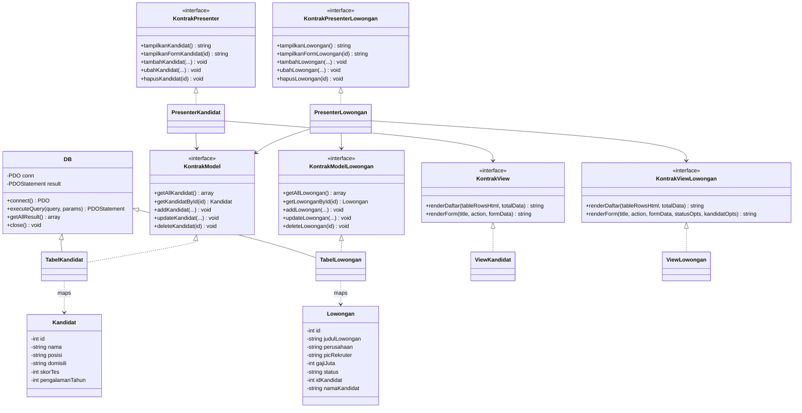
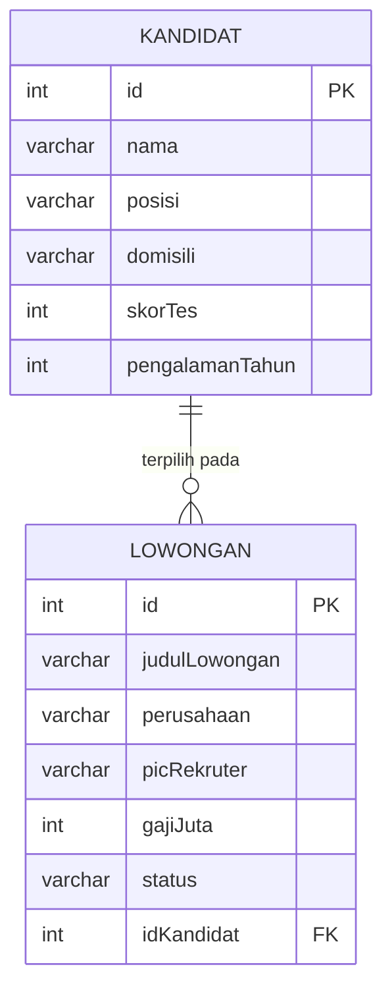
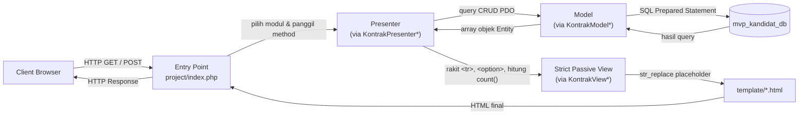
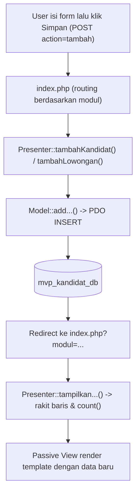
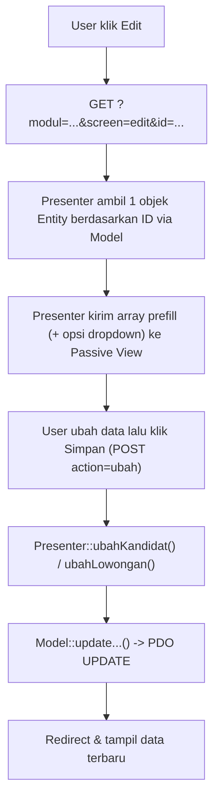
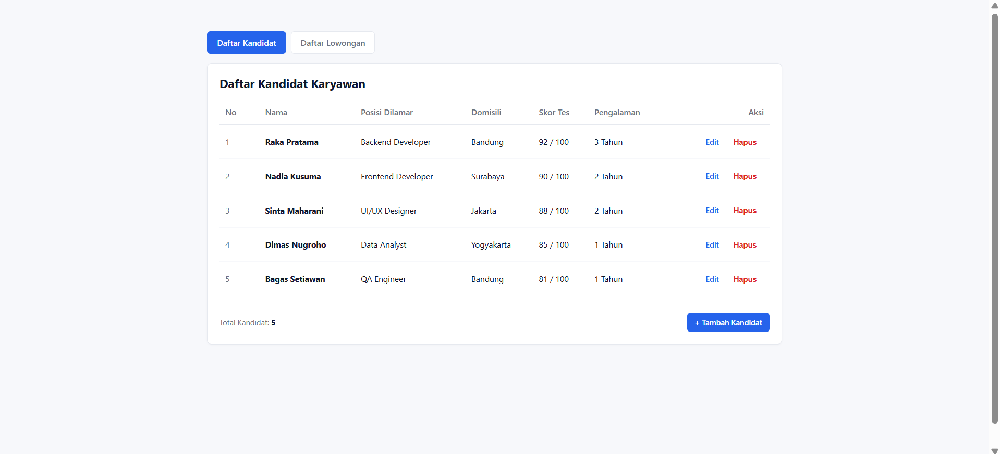
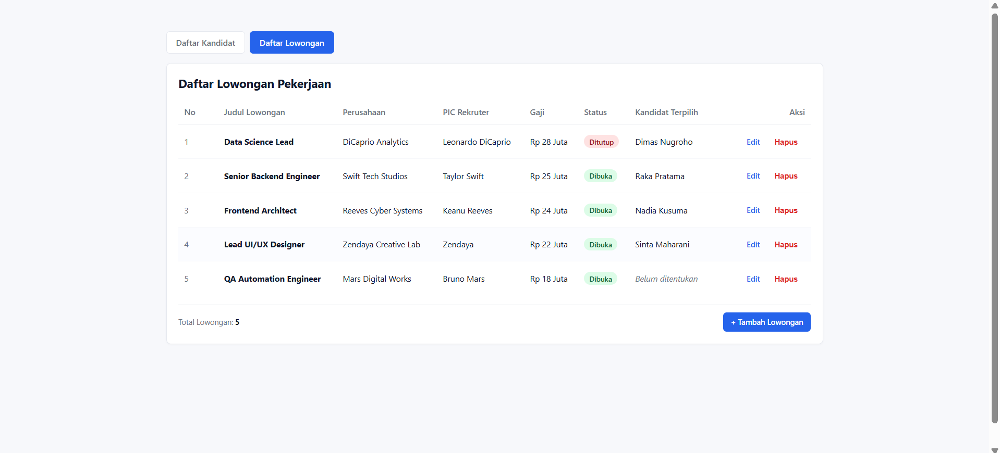

# TP9DPBO2526C2: Sistem Manajemen Rekrutmen & Lowongan (MVP Strict Passive View PHP Native)

> Tugas Praktikum 9 (Modul 10), Desain dan Pemrograman Berorientasi Objek (DPBO)  
> Web berbasis **PHP Native** dengan pola arsitektur **MVP (Model–View–Presenter)** pendekatan **Strict Passive View (*Dumb View*)**, **OOP + Interface Contract**, **PDO Prepared Statements**, dan database **MySQL**.

### Janji

Saya `Moch Fadillah Pratama` dengan NIM `2506968` mengerjakan Tugas Praktikum 9 dalam mata kuliah Desain dan Pemrograman Berorientasi Objek untuk keberkahanNya maka saya tidak melakukan kecurangan seperti yang telah dispesifikasikan. Aamiin.

---

## 1. Tema Website & Latar Belakang

Aplikasi ini adalah **sistem manajemen rekrutmen karyawan** yang dikembangkan dari *starter template* `MVP_Kandidat`. Pengembangan mencakup dua fokus utama sesuai ketentuan Modul 10:

1. **Melengkapi Modul Starter (`kandidat`):** mengimplementasikan fitur *Read*, tampilan *Form*, serta operasi *Create*, *Update*, dan *Delete* menggunakan *PDO Prepared Statements* dan penanganan request `POST` (`tambah`, `ubah`, `hapus`) di `index.php`.
2. **Menambahkan Modul MVP Baru (`lowongan`):** menambahkan satu tabel dan modul bertema HR/rekrutmen yang mencatat lowongan pekerjaan beserta perusahaan, PIC rekruter (bertema artis kelas dunia), estimasi gaji, status lowongan, dan kandidat terpilihnya.

Kedua tabel dihubungkan melalui relasi *Foreign Key* opsional (`lowongan.idKandidat -> kandidat.id`), sehingga tabel lowongan menampilkan **nama kandidat terpilih** (bukan angka ID) melalui `LEFT JOIN` sekaligus tetap menampilkan lowongan yang belum memiliki kandidat terpilih.

---

## 2. Fitur Utama

| Entitas | Implementasi CRUD | Relasi & Catatan |
|---|---|---|
| **Kandidat** | **Create:** Form tambah kandidat baru (`POST action=tambah`)<br>**Read:** Tabel daftar kandidat terurut dari `skorTes` tertinggi<br>**Update:** Form edit terisi otomatis (*prefill*, `POST action=ubah`)<br>**Delete:** Tombol hapus via `POST action=hapus` dengan dialog konfirmasi | Menjadi tabel referensi bagi `lowongan`. Jika kandidat yang terpilih dihapus, data lowongan tetap tersimpan dan `idKandidat` otomatis menjadi `NULL` (`ON DELETE SET NULL`). |
| **Lowongan** | **Create:** Form tambah lowongan lengkap dengan *dropdown* status & kandidat<br>**Read:** Tabel daftar lowongan terurut dari `gajiJuta` tertinggi dengan *badge* status<br>**Update:** Form edit *prefill* (termasuk opsi terpilih pada kedua *dropdown*)<br>**Delete:** Tombol hapus via `POST action=hapus` dengan dialog konfirmasi | Menampilkan nama kandidat terpilih melalui `LEFT JOIN kandidat`; jika `idKandidat` bernilai `NULL`, tampil label *Belum ditentukan*. |

Fitur pendukung:

- **Navigasi tab antar modul** (`Daftar Kandidat` dan `Daftar Lowongan`) melalui satu *entry point* `index.php` dengan parameter `?modul=...`.
- **Strict Passive View (*Dumb View*):** seluruh file pada folder `views/` bebas dari `require_once` Model/Entity, bebas perulangan (`foreach`, `for`, `while`), dan bebas fungsi agregasi (`count()`).
- **Komunikasi berbasis Contract / Interface:** seluruh interaksi Model, View, dan Presenter diikat melalui `KontrakModel*`, `KontrakView*`, dan `KontrakPresenter*`.
- **Keamanan & Pola PRG (*Post/Redirect/Get*):** seluruh query menggunakan *PDO Prepared Statements*, output teks disaring dengan `htmlspecialchars()`, dan setiap aksi `POST` diakhiri *redirect*.

---

## 3. Teknologi

- **PHP Native** (tanpa framework), paradigma OOP dengan *Interface Contract*
- Pola arsitektur **MVP (Model–View–Presenter)** edisi **Strict Passive View**
- **PDO (PHP Data Objects)** dengan *Prepared Statements* untuk keamanan query SQL
- **MySQL / MariaDB** (InnoDB, Foreign Key `ON DELETE SET NULL ON UPDATE CASCADE`)
- **HTML5 + CSS3 Native** dengan penggantian *placeholder* token `{{...}}`
- Server lokal: **Laragon** / **XAMPP**

---

## 4. Desain Program & Arsitektur MVP

### 4.1 Pendekatan MVP Strict Passive View vs MVC

Berbeda dengan pola **MVC** di mana View masih dapat berinteraksi langsung dengan Model atau membaca objek entitas, pada pola **MVP Strict Passive View** yang diterapkan pada proyek ini:

- **Model (`models/`):** bertanggung jawab penuh atas koneksi database (`DB`), pemetaan baris SQL ke kelas entitas (`Kandidat`, `Lowongan`), serta eksekusi query CRUD dengan *prepared statement*. Model hanya berkomunikasi dengan Presenter.
- **View (`views/` & `template/`):** dibuat 100% pasif (*dumb view*). View tidak mengenal class Model/Entity, tidak menerima array objek, tidak melakukan `foreach`, dan tidak menghitung `count()`. Tugasnya hanya membaca file HTML dan mengganti token *placeholder* seperti `{{TABLE_ROWS}}`, `{{TOTAL_DATA}}`, `{{STATUS_OPTIONS}}`, dan `{{KANDIDAT_OPTIONS}}`.
- **Presenter (`presenters/`):** menjadi pusat komunikasi, *business logic*, dan *presentation logic*. Presenter mengambil data dari Model, menghitung total baris (`count()`), merakit potongan HTML baris tabel (`<tr>...</tr>`) beserta opsi `<option>` *dropdown*, lalu menyerahkan string siap tampil ke View.

### 4.2 Penggunaan Interface (Contract)

Setiap layer pada kedua modul berkomunikasi melalui *interface* (`KontrakModel`, `KontrakView`, `KontrakPresenter` untuk modul `kandidat`; serta `KontrakModelLowongan`, `KontrakViewLowongan`, `KontrakPresenterLowongan` untuk modul `lowongan`). Penerapan *interface* memberikan empat keuntungan utama:

1. **Abstraction:** menyembunyikan detail implementasi internal; komponen pemanggil cukup mengetahui tanda tangan *method* yang tersedia.
2. **Decoupling:** Presenter bergantung pada kontrak *interface*, bukan kelas konkret Model atau View.
3. **Testability:** logika Presenter dapat diuji secara terpisah menggunakan *mock* Model dan *mock* View yang mengimplementasikan kontrak yang sama.
4. **Parallel Development:** pengembangan View, Model, dan Presenter dapat dikerjakan bersamaan cukup dengan menyepakati kontrak *interface*.

### 4.3 Diagram Kelas (Class Diagram MVP)



### 4.4 Struktur Direktori Repository

```text
TP9DPBO2526C2/
├── project/
│   ├── index.php                              # Entry point & routing GET/POST modul kandidat & lowongan
│   ├── models/
│   │   ├── DB.php                             # Koneksi PDO & eksekusi prepared statement
│   │   ├── Kandidat.php                       # Entity data kandidat
│   │   ├── KontrakModel.php                   # Interface Model modul kandidat
│   │   ├── TabelKandidat.php                  # Implementasi CRUD tabel kandidat
│   │   ├── Lowongan.php                       # Entity data lowongan (+ namaKandidat hasil LEFT JOIN)
│   │   ├── KontrakModelLowongan.php           # Interface Model modul lowongan
│   │   └── TabelLowongan.php                  # Implementasi CRUD tabel lowongan + LEFT JOIN kandidat
│   ├── presenters/
│   │   ├── KontrakPresenter.php               # Interface Presenter modul kandidat
│   │   ├── PresenterKandidat.php              # Logika bisnis & perakitan HTML tabel kandidat
│   │   ├── KontrakPresenterLowongan.php       # Interface Presenter modul lowongan
│   │   └── PresenterLowongan.php              # Logika bisnis, perakitan HTML tabel & dropdown lowongan
│   ├── views/
│   │   ├── KontrakView.php                    # Interface Strict Passive View modul kandidat
│   │   ├── ViewKandidat.php                   # View pasif kandidat (str_replace placeholder HTML)
│   │   ├── KontrakViewLowongan.php            # Interface Strict Passive View modul lowongan
│   │   └── ViewLowongan.php                   # View pasif lowongan (str_replace placeholder HTML)
│   └── template/
│       ├── skin.html                          # Template daftar kandidat + tab navigasi
│       ├── form.html                          # Template form tambah/ubah kandidat
│       ├── skin_lowongan.html                 # Template daftar lowongan + tab navigasi
│       └── form_lowongan.html                 # Template form tambah/ubah lowongan
├── dokumentasi/                               # Video screenrecord & screenshot demo program
├── mvp_db.sql                                 # Export SQL terbaru (tabel kandidat & lowongan)
└── README.md
```

| Folder / File | Fungsi |
|---|---|
| `project/models/` | Berisi `DB.php`, kelas entitas (`Kandidat`, `Lowongan`), kontrak *interface* (`KontrakModel*`), dan kelas tabel penyimpan seluruh query CRUD PDO serta `LEFT JOIN` |
| `project/presenters/` | Berisi kontrak *interface* (`KontrakPresenter*`) dan Presenter pengendali *business logic*, perhitungan `count()`, serta perakitan baris `<tr>` dan opsi `<option>` |
| `project/views/` | Berisi kontrak *interface* (`KontrakView*`) dan View pasif murni yang hanya membaca template HTML dan mengganti *placeholder* `{{...}}` dengan `str_replace()` |
| `project/template/` | File HTML murni tanpa logika PHP untuk halaman daftar dan form kedua modul |
| `project/index.php` | *Entry point* & *router* yang membaca parameter `modul`, `screen`, dan `action` (`GET`/`POST`), menginstansiasi komponen MVP, lalu memanggil *method* Presenter |
| `dokumentasi/` | Berisi rekaman layar (*screenrecord*) jalannya seluruh fitur CRUD dan tangkapan layar aplikasi |
| `mvp_db.sql` | Skema database `mvp_kandidat_db` mencakup tabel `kandidat`, tabel `lowongan`, relasi *Foreign Key*, dan data awal |

---

## 5. Desain Database

**Nama database:** `mvp_kandidat_db`, terdiri dari **2 tabel** dengan **1 relasi foreign key**.

### 5.1 ERD



### 5.2 Tabel `kandidat`: data pelamar kerja (tabel utama)

| Kolom | Tipe Data | Keterangan |
|---|---|---|
| `id` | `INT AUTO_INCREMENT` | Primary key, auto increment |
| `nama` | `VARCHAR(100)` | Nama lengkap kandidat |
| `posisi` | `VARCHAR(100)` | Posisi yang dilamar |
| `domisili` | `VARCHAR(100)` | Kota domisili kandidat |
| `skorTes` | `INT` | Nilai skor tes seleksi (0–100) |
| `pengalamanTahun` | `INT` | Lama pengalaman kerja dalam satuan tahun |

### 5.3 Tabel `lowongan`: data lowongan pekerjaan (tabel baru)

| Kolom | Tipe Data | Keterangan |
|---|---|---|
| `id` | `INT AUTO_INCREMENT` | Primary key, auto increment |
| `judulLowongan` | `VARCHAR(100)` | Nama posisi lowongan yang dibuka |
| `perusahaan` | `VARCHAR(100)` | Nama perusahaan atau studio penyelenggara |
| `picRekruter` | `VARCHAR(100)` | Nama PIC / rekruter penanggung jawab (bertema artis kelas dunia) |
| `gajiJuta` | `INT` | Estimasi gaji bulanan dalam satuan juta Rupiah |
| `status` | `VARCHAR(30)` | Status lowongan (`Dibuka` atau `Ditutup`) |
| `idKandidat` | `INT` (*nullable*) | **FK -> `kandidat.id`** sebagai kandidat unggulan/terpilih |

### 5.4 Relasi Foreign Key

| Relasi | ON DELETE | ON UPDATE | Alasan |
|---|---|---|---|
| `lowongan.idKandidat -> kandidat.id` | `SET NULL` | `CASCADE` | Lowongan tetap tersimpan meskipun data kandidat terkait dihapus; kolom kandidat terpilih otomatis menjadi `NULL` dan tampil sebagai *Belum ditentukan* |

---

## 6. Detail Implementasi Komponen MVP

### 6.1 Layer Model (`project/models/`)

| Komponen | Method / Tanggung Jawab |
|---|---|
| `DB` | Membuka koneksi PDO (`connect()`), mengeksekusi query berparameter (`executeQuery()`), dan mengambil hasil (`getAllResult()`) |
| `TabelKandidat` | Mengimplementasikan `KontrakModel`: `getAllKandidat()` (urut `skorTes DESC, id ASC`), `getKandidatById(int $id)`, `addKandidat(...)`, `updateKandidat(...)`, dan `deleteKandidat(int $id)` memakai *prepared statement* |
| `TabelLowongan` | Mengimplementasikan `KontrakModelLowongan`: `getAllLowongan()` dan `getLowonganById(int $id)` dengan `LEFT JOIN kandidat`, serta `addLowongan(...)`, `updateLowongan(...)`, dan `deleteLowongan(int $id)` memakai *prepared statement* |

### 6.2 Layer View & Template (`project/views/` & `project/template/`)

| Komponen | Placeholder yang Diganti |
|---|---|
| `ViewKandidat` (`skin.html`, `form.html`) | `{{TABLE_ROWS}}`, `{{TOTAL_DATA}}`, `{{FORM_TITLE}}`, `{{ACTION}}`, `{{ID}}`, `{{NAMA}}`, `{{POSISI}}`, `{{DOMISILI}}`, `{{SKOR_TES}}`, `{{PENGALAMAN_TAHUN}}` |
| `ViewLowongan` (`skin_lowongan.html`, `form_lowongan.html`) | `{{TABLE_ROWS}}`, `{{TOTAL_DATA}}`, `{{FORM_TITLE}}`, `{{ACTION}}`, `{{ID}}`, `{{JUDUL_LOWONGAN}}`, `{{PERUSAHAAN}}`, `{{PIC_REKRUTER}}`, `{{GAJI_JUTA}}`, `{{STATUS_OPTIONS}}`, `{{KANDIDAT_OPTIONS}}` |

### 6.3 Layer Presenter (`project/presenters/`)

| Komponen | Method Utama & Helper |
|---|---|
| `PresenterKandidat` | `__construct()`, `tampilkanKandidat()`, `tampilkanFormKandidat(?int $id)`, `tambahKandidat(...)`, `ubahKandidat(...)`, `hapusKandidat(int $id)`, serta helper privat `buildRowHtml()` |
| `PresenterLowongan` | `__construct()`, `tampilkanLowongan()`, `tampilkanFormLowongan(?int $id)`, `tambahLowongan(...)`, `ubahLowongan(...)`, `hapusLowongan(int $id)`, serta helper privat `buildRowHtml()`, `buildStatusOptionsHtml()`, dan `buildKandidatOptionsHtml()` |

### 6.4 Entry Point & Routing (`project/index.php`)

- **Pemilihan Modul:** membaca `$_POST['modul'] ?? $_GET['modul'] ?? 'kandidat'` untuk memilih alur modul `kandidat` atau `lowongan`.
- **Request GET:** membaca `$_GET['screen']` (`list`, `add`, atau `edit` dengan `id`) lalu mencetak string HTML hasil render Presenter.
- **Request POST:** membaca `$_POST['action']` bernilai `'tambah'`, `'ubah'`, atau `'hapus'`, membersihkan input (`trim` / *type casting* `int` & `null`), lalu meneruskannya ke Presenter terkait.

---

## 7. Penjelasan Alur Program

### 7.1 Alur Umum (Request–Response MVP)



### 7.2 Rincian Alur Tiap Operasi

1. **Read (Menampilkan Tabel):** Pengguna membuka `index.php` (bawaan `modul=kandidat`) atau mengklik tab `index.php?modul=lowongan`. *Entry point* memanggil `tampilkanKandidat()` atau `tampilkanLowongan()`. Presenter mengambil seluruh data dari Model (`LEFT JOIN` untuk lowongan), menghitung `count()`, merakit seluruh baris `<tr>...</tr>`, lalu menyerahkannya ke View untuk dirender ke `skin.html` atau `skin_lowongan.html`.
2. **Create (Menambah Data):** Pengguna menekan **+ Tambah** (`GET ?modul=...&screen=add`). Presenter merender form kosong (untuk lowongan, sekaligus menyusun tag `<option>` status dan daftar kandidat). Saat tombol **Simpan** ditekan (`POST action=tambah`), `index.php` meneruskan data ke Presenter -> Model (`INSERT` PDO) -> *redirect* kembali ke halaman daftar modul.
3. **Update (Mengubah Data / Prefill):** Pengguna menekan **Edit** (`GET ?modul=...&screen=edit&id=...`). Presenter meminta satu entitas berdasarkan ID dari Model, mengekstraknya menjadi array data sederhana (*prefill*), merakit opsi *dropdown* terpilih (untuk lowongan), dan memerintahkan View merender form ubah. Saat **Simpan** ditekan (`POST action=ubah`), Presenter memanggil Model (`UPDATE` PDO) lalu *redirect* ke halaman daftar.
4. **Delete (Menghapus Data):** Pengguna menekan **Hapus** dan menyetujui dialog konfirmasi. Form inline mengirim request `POST` (`action=hapus` dan `id`), Presenter memanggil Model (`DELETE` PDO), lalu melakukan *redirect* (*Post/Redirect/Get*) kembali ke halaman daftar modul.

### 7.3 Diagram Alur Create



### 7.4 Diagram Alur Update



### 7.5 Perilaku Delete & Dampak Relasi

| Entitas | Perilaku |
|---|---|
| **Kandidat** | `DELETE` berhasil. Jika kandidat tersebut sebelumnya dipilih pada suatu lowongan, data lowongan tetap tersimpan dan kolom `idKandidat` otomatis berubah menjadi `NULL` (*Belum ditentukan*) karena `ON DELETE SET NULL`. |
| **Lowongan** | `DELETE` berhasil tanpa memengaruhi data pada tabel `kandidat`. |

---

## 8. Pemenuhan Spesifikasi Tugas (Modul 10 / TP9)

| Kategori | Spesifikasi Modul 10 | Bukti Implementasi |
|---|---|---|
| **Latihan Starter (Read & Form)** | Melengkapi `getAllKandidat()`, `getKandidatById()`, `__construct()`, `tampilkanKandidat()`, dan `tampilkanFormKandidat()` | `project/models/TabelKandidat.php`, `project/presenters/PresenterKandidat.php` |
| **Tugas CRUD Starter (`kandidat`)** | Melengkapi `addKandidat()`, `updateKandidat()`, `deleteKandidat()` (*prepared statement*), `tambah/ubah/hapusKandidat()`, dan penanganan POST `action` `'tambah'`, `'ubah'`, `'hapus'` | `project/models/TabelKandidat.php`, `project/presenters/PresenterKandidat.php`, `project/index.php` |
| **Modul MVP Baru** | Menambahkan 1 tabel & modul MVP bertema HR/rekrutmen lengkap dengan CRUD (Create, Read, Update *prefill*, Delete) | Tabel `lowongan` (berelasi FK + `LEFT JOIN` ke `kandidat`) beserta Entity, Model, View, Presenter, dan Template |
| **Strict Passive View** | View tidak berhubungan dengan Model/Entity (`require_once`), bebas `foreach`, dan bebas `count()` | `project/views/ViewKandidat.php`, `project/views/ViewLowongan.php` |
| **Interface / Contract** | Seluruh komunikasi antar komponen menggunakan *contract / interface* | `KontrakModel*`, `KontrakView*`, `KontrakPresenter*` pada kedua modul |
| **Struktur Repository** | Folder `project/`, folder `dokumentasi/` (diutamakan *screenrecord*), file `mvp_db.sql` terbaru, `README.md`, nama repo `TP9DPBO2526C2` bersifat *Public* | Struktur root repositori GitHub `TP9DPBO2526C2` |

---

## 9. Cara Menjalankan Program

1. **Clone repository**

   ```bash
   git clone https://github.com/mochcom/TP9DPBO2526C2.git
   ```

2. **Letakkan folder `project/`** di direktori `www/` (Laragon) atau `htdocs/` (XAMPP).

3. **Nyalakan layanan** Apache dan MySQL melalui Laragon / XAMPP.

4. **Import database.** Buka HeidiSQL atau phpMyAdmin, lalu muat dan jalankan file `mvp_db.sql` (otomatis membuat database `mvp_kandidat_db` beserta tabel `kandidat`, tabel `lowongan`, relasi *Foreign Key*, dan data awal).

5. **Periksa konfigurasi koneksi database** di `project/index.php` (bawaan Laragon/XAMPP):

   ```php
   $host     = 'localhost';
   $dbName   = 'mvp_kandidat_db';
   $username = 'root';
   $password = '';
   ```

6. **Buka aplikasi di browser:**

   ```text
   http://localhost:8080/TP9DPBO2526C2/project/index.php
   ```

   *(Sesuaikan path folder dan port web server lokal, misalnya `http://localhost/TP9DPBO2526C2/project/index.php` jika menggunakan XAMPP port standar 80.)*

---

## 10. Dokumentasi Program (Screenrecord & Screenshot)

### Video Demo (Screenrecord CRUD Seluruh Modul)

- **Tautan Video Demo:** [Tonton Screenrecord Demo Program](https://drive.google.com/drive/folders/1lmPx-lWrDHpgmaCtexVKWO8NNMXcQwLx) 

Urutan skenario yang didemonstrasikan pada rekaman layar:

1. **Modul Kandidat:** menampilkan tabel daftar terurut skor tes, tambah kandidat baru, edit data (*prefill*), dan hapus data uji.
2. **Modul Lowongan:** berpindah ke tab **Daftar Lowongan**, menampilkan data lowongan bertema artis kelas dunia beserta kolom kandidat terpilih hasil `LEFT JOIN` (termasuk data dengan label *Belum ditentukan*), tambah lowongan baru dengan memilih kandidat terpilih, edit (*prefill* input dan *dropdown*), serta hapus data uji.
3. **Pengujian Relasi `ON DELETE SET NULL`:** menghapus kandidat yang terhubung ke suatu lowongan dan memastikan lowongan tetap tampil normal dengan status kandidat *Belum ditentukan*.

### Screenshot




---

## Catatan

- **Kepatuhan Strict Passive View:** Seluruh logika pengambilan data, agregasi `count()`, perakitan `<tr>`, serta opsi `<option>` diisolasi di Presenter; View hanya berfungsi sebagai pengisi *placeholder* template HTML.
- **Keamanan & Integritas Data:** Seluruh query memakai *PDO Prepared Statements* untuk mencegah SQL Injection, tampilan HTML disaring dengan `htmlspecialchars()` untuk mencegah XSS, dan integritas relasi dijaga oleh `FOREIGN KEY ... ON DELETE SET NULL ON UPDATE CASCADE`.